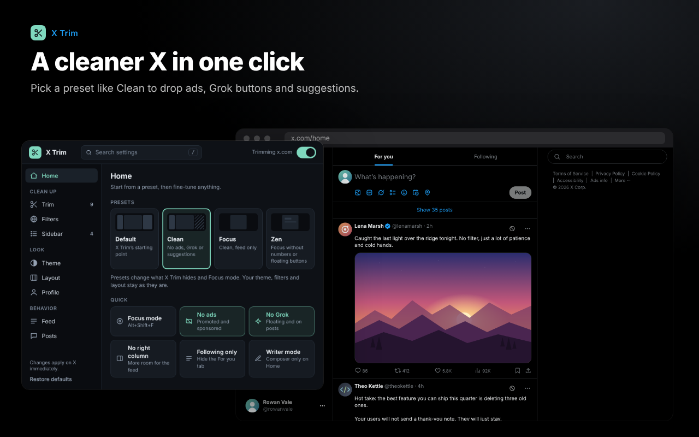
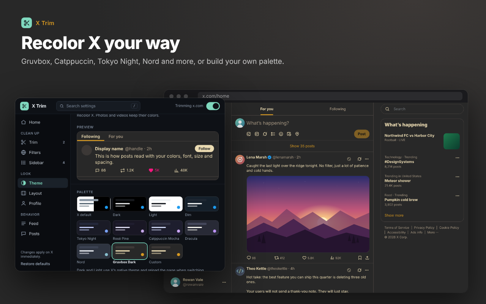

<div align="center">


# X Trim

A cleaner, calmer X. Hide what you don't want, theme the rest.

[](https://addons.mozilla.org/en-US/firefox/addon/x-trim/)
[](#install)
[](LICENSE)

[Install](#install) · [Features](#features) · [Privacy](#privacy) · [Development](#development) · [Follow along](#follow-along)

<br>

<a href="https://addons.mozilla.org/en-US/firefox/addon/x-trim/"></a>

</div>

## Install

**Firefox and Zen (140+, Android 142+):** get it from **[Firefox Add-ons](https://addons.mozilla.org/en-US/firefox/addon/x-trim/)**. Stable, and it updates on its own.

**Chrome (116+):** unzip [`x-trim-chrome.zip`](dist/x-trim-chrome.zip), open `chrome://extensions`, turn on **Developer mode**, click **Load unpacked** and pick the unzipped folder.

Then open [x.com](https://x.com) and click the X Trim button in your toolbar. If X Trim only works after you click it, choose **Always allow on X** in the popup.

<details>
<summary><b>Try the experimental build</b> (newest changes, unsigned)</summary>

<br>

Open `about:debugging#/runtime/this-firefox`, click **Load Temporary Add-on**, then choose one:

- **XPI:** [`x-trim.xpi`](dist/x-trim.xpi), no extraction needed.
- **ZIP:** [`x-trim.zip`](dist/x-trim.zip), selected directly.
- **Source:** clone or download this repo and select `manifest.json`.

Temporary installs last until the browser restarts. See [Mozilla's guide](https://extensionworkshop.com/documentation/develop/temporary-installation-in-firefox/) for details.

</details>

## Features

Everything lives in one toolbar popup. Start from a preset (**Default**, **Clean**, **Focus** or **Zen**), then fine-tune. Press <kbd>/</kbd> to search every setting. Changes apply to X right away.

### Clean up

- **Trim:** hide ads, paid partnerships, Grok, Who to follow, trends, floating buttons, Explore page sections and any sidebar item.
- **Filters:** collapse, highlight or hide posts by keyword or `/regex/`, Premium replies, posts without media, or the author's country.
- **Sidebar:** pick which links X's side navigation shows, including Calls, Money and anything from the More menu.

<p align="center"></p>

### Look

- **Theme:** Dim, Tokyo Night, Rosé Pine, Catppuccin, Dracula, Nord, Gruvbox or your own colors. Change the font, post text size and spacing, or add custom CSS.
- **Layout:** Chat and Calls page widths, Focus mode (<kbd>Alt</kbd>+<kbd>Shift</kbd>+<kbd>F</kbd>) and Writer mode.
- **Profile:** square profile pictures, post count beside Followers, Media opening on Photos, and a card showing where an account is based.

<p align="center"></p>

<p align="center"></p>

### Behavior

- **Feed:** open Home on Following sorted by Recent, auto-load new posts, show exact counts and real timestamps, and set a daily time limit.
- **Posts:** a one-click Block button, fast block, and downloads for original images, MP4 videos and GIFs.

<details>
<summary><b>More on account details, country filtering and downloads</b></summary>

#### Account details

Turn it on under Profile or Posts. A small flag and connection badge opens a card with location, connection source, creation date, user ID and affiliation. Missing values stay missing; nothing is guessed.

#### Country filtering

Open **Filters**, enter country names or two-letter codes, and turn filtering on. Choose **Collapse**, **Highlight** or **Fully hide**, and list accounts that should always show. Region names match X's label exactly. Unknown locations, opened posts and quoted accounts are never hidden.

#### Downloads and GIFs

Turn on downloads under **Posts** and approve access to `video.twimg.com` once. Images save at original size and videos as the best available MP4. HLS-only videos aren't supported. Reload a post after enabling so X Trim can see its video data.

X GIFs convert on your device to looping `.gif` files: up to 480 px, 12 fps, 32 MB and 30 seconds per clip, one at a time. In Zen, conversion opens a short-lived tab; keep it open until the file saves.

</details>

## Privacy

- Settings stay in your browser. No analytics, no tracking, no third-party servers.
- Account details, country filtering and downloads are off until you turn them on and approve consent. They talk only to X, and results are cached locally for 24 hours.
- Ads and labels are spotted in data X already sends, so nothing extra is requested.

Full details in [PRIVACY.md](PRIVACY.md).

> [!NOTE]
> X changes often, so a setting can break now and then. Ad matching works best in English. If something stops working, [open an issue](https://github.com/LeopoldN/X-Trim/issues) with steps to reproduce.

## Development

Plain JavaScript and CSS. No build step, no dependencies to install.

```
content/         Scripts and styles that run on x.com
background/      Reads X's responses, handles downloads, GIF jobs and counters
popup/           The toolbar popup
shared/          Code used by both the background and the popup
gif-converter/   Tab that converts GIFs locally
chrome/          Chrome manifest, icons and shims
vendor/gif.js/   Unmodified gif.js 0.2.0
tests/           Node, Playwright and Firefox checks
scripts/         package.py builds everything in dist/
```

```sh
python3 scripts/package.py      # rebuild dist/
node tests/<name>.cjs           # run a test
npx web-ext@10.8.0 lint         # lint the Firefox build
```

<details>
<summary><b>How the Chrome build differs</b></summary>

`manifest.json` is for Firefox and `chrome/manifest.json` is for Chrome. `scripts/package.py` puts the Chrome one in `dist/x-trim-chrome.zip` and fails if the two drift apart.

- **X's API replies:** Chrome can't read responses like Firefox's `filterResponseData`, so `chrome/page-hook.js` watches X's own requests in the page and `chrome/page-bridge.js` passes them to the same background readers. It changes and stores nothing.
- **Background:** `chrome/service-worker.js` loads the same background scripts. Chrome stops it when idle, so in-memory caches can reset.
- **API names:** `chrome/browser-compat.js` maps `browser.*` calls onto `chrome.*`.
- **Data consent:** Chrome has no built-in consent prompt, so the popup records it in X Trim's own storage.

</details>

**gif.js:** `vendor/gif.js/` is the unchanged npm release ([tarball](https://registry.npmjs.org/gif.js/-/gif.js-0.2.0.tgz)), kept with its source, build script and source maps for review. Packages include only its two `dist/` scripts and license.

**Store and review:** [AMO listing](review/AMO-LISTING.md), [reviewer notes](review/REVIEWER-NOTES.md) and [check results](review/CHECKS.md).

## Follow along

<!-- Replace YOUR_HANDLE in each link below with your own handles. Delete any you don't use. -->

[](https://x.com/LeopoldNick)
[](https://github.com/LeopoldN)

Like X Trim? A ⭐ on this repo or a review on [Firefox Add-ons](https://addons.mozilla.org/en-US/firefox/addon/x-trim/reviews/) helps others find it.

## License & credits

Original code and docs are public domain under [CC0 1.0](LICENSE). Use, change, share or sell them, no credit required. Third-party work keeps its own terms.

Palettes: [Tokyo Night](https://github.com/folke/tokyonight.nvim), [Rosé Pine](https://rosepinetheme.com/palette/), [Catppuccin](https://catppuccin.com/palette/), [Dracula](https://draculatheme.com/contribute), [Nord](https://www.nordtheme.com/docs/colors-and-palettes/), [Gruvbox](https://github.com/morhetz/gruvbox). GIF encoding: [gif.js](https://github.com/jnordberg/gif.js) 0.2.0 (MIT). The account details card is independently written, with visual inspiration from [xaitax](https://github.com/xaitax/x-account-location-device); no reference code is bundled. Several usability features follow approaches from [Control Panel for Twitter](https://github.com/insin/control-panel-for-twitter) by Jonny Buchanan (MIT). Notices are in [`THIRD_PARTY_NOTICES.txt`](THIRD_PARTY_NOTICES.txt).

<sub>X Trim is an independent project and isn't affiliated with or endorsed by X Corp.</sub>
